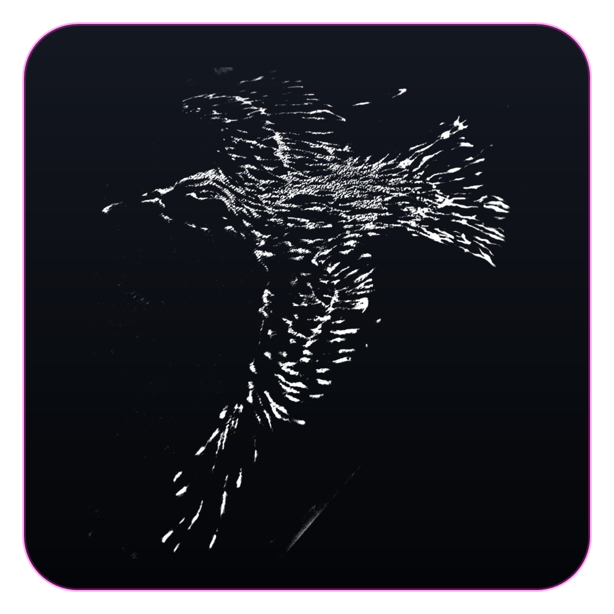
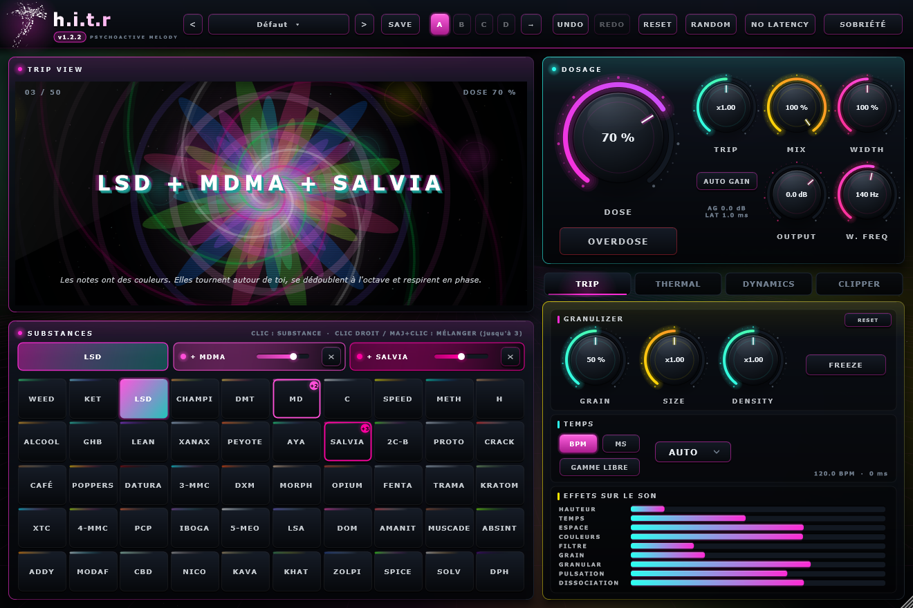
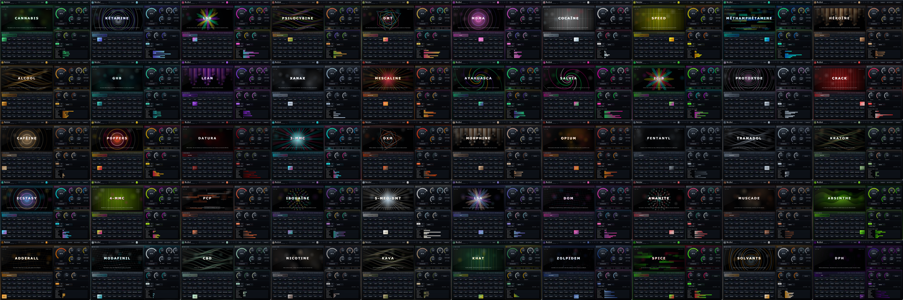

<p align="center"></p>

# h.i.t.r

**Psychoactive melody** — un plugin VST3 / AU qui fait entendre une mélodie comme on la ressentirait sous 50 substances, seules ou mélangées.



## 50 substances

Cannabis · Kétamine · LSD · Psilocybine · DMT · MDMA · Cocaïne · Speed · Méthamphétamine · Héroïne · Alcool · GHB · Lean · Xanax · Mescaline · Ayahuasca · Salvia · 2C-B · Protoxyde · Crack · Caféine · Poppers · Datura · 3-MMC · DXM · Morphine · Opium · Fentanyl · Tramadol · Kratom · Ecstasy · 4-MMC · PCP · Ibogaïne · 5-MeO-DMT · LSA · DOM · Amanite · Muscade · Absinthe · Adderall · Modafinil · CBD · Nicotine · Kava · Khat · Zolpidem · Spice · Solvants · DPH

Chaque substance a son mélange d'effets (espace, filtre qui respire, échos, chorus, phaser, saturation, bégaiements, trous de mémoire, granulizer…), sa palette et son visuel animé.



## Mélange

**Clic** sur une substance = substance principale. **Clic droit / Maj+clic** = l'ajouter au mélange (jusqu'à 3), chaque couche a son dosage. Les visuels se superposent aussi. Presets d'usine : Candyflip, Hippie Flip, Kitty Flip, Calvin Klein, Speedball, Purple Haze, Nexus Flip, Trainwreck…

## Contrôles

| Zone | Contrôles |
|---|---|
| **Header** | presets (page avec catégories, recherche, SAVE / IMPORT / EXPORT / SUPPR. / DOSSIER), slots **A B C D** + copie, **UNDO / REDO** (Ctrl+Z / Ctrl+Y), **RESET**, **RANDOM** (ne touche pas au temps ni à la sortie), **NO LATENCY**, **SOBRIÉTÉ** (bypass) |
| **DOSAGE** | DOSE, **OVERDOSE**, TRIP, MIX, WIDTH, **W. FREQ** (sous cette fréquence les basses restent mono), OUTPUT, **AUTO GAIN** |
| **TRIP** | granulizer (GRAIN, SIZE, DENSITY, FREEZE), temps **BPM / MS** (division ou millisecondes), GAMME LIBRE, effets sur le son |
| **THERMAL** | distorsion à 2 étages en mouvement, à niveau constant (aucun pic, volume stable) : HEAT, caractère (TUBE, FUZZ, FOLD, RECTIFY, BITS, MELT), MOVE calé sur le tempo, TONE, MIX |
| **DYNAMICS** | OTT (DEPTH, TIME, LOW / MID / HIGH), SAUSAGE FATTENER (FATTEN, COLOR), TONE (TONE, LOW, AIR) |
| **CLIPPER** | le clipper de ravenn : **IN** + CLIPPER reliés par **LINK** (comme ravenn), HARD / SOFT / TUBE, KNEE, bande FULL / LOW / MID / HIGH, M/S, **BODY**, suréchantillonnage x1 → x8 |

Chaque onglet a son propre **RESET**.

## Qualité audio

- Lectures interpolées Hermite, saturations anti-aliasées (ADAA) et étage THERMAL / FATTENER / CLIPPER suréchantillonné (FIR, phase linéaire)
- Reverb FDN 8 lignes modulée, modulations bridées (< 7 cents) : la gamme ne bouge jamais sans GAMME LIBRE
- Paramètres lissés à l'échantillon, mix à puissance constante, anti-DC, même volume perçu d'une substance à l'autre
- SOBRIÉTÉ : fondu sans clic, latence compensée (vérifié à l'échantillon près par le test)

## Installer

Télécharge l'installeur dans l'onglet **Releases** :

- **Windows** : `hitr-…-windows.zip` → copie `h.i.t.r.vst3` dans `C:\Program Files\Common Files\VST3\`
- **Mac** (Intel et Apple Silicon) : `hitr-…-macos.pkg` installe le VST3, l'AU et l'application.
  Le plugin n'est pas notarisé par Apple : au premier lancement, clic droit sur le `.pkg` → **Ouvrir**.

## Compiler

```
cmake -B build
cmake --build build --config Release --target hitr_VST3 hitr_Standalone hitrTest
```

JUCE 8.0.12 est téléchargé automatiquement (ou `-DJUCE_PATH=...`). `hitrTest` vérifie les 50 substances dans 3 configurations + le bypass ; `hitrTest --snap <dossier>` produit les captures de l'interface.
